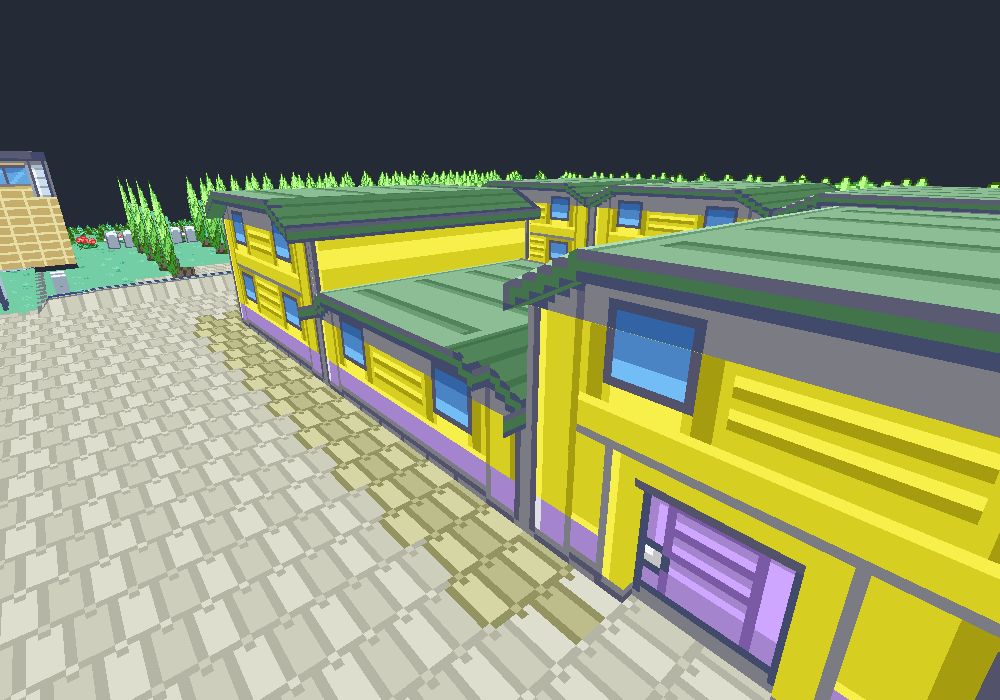
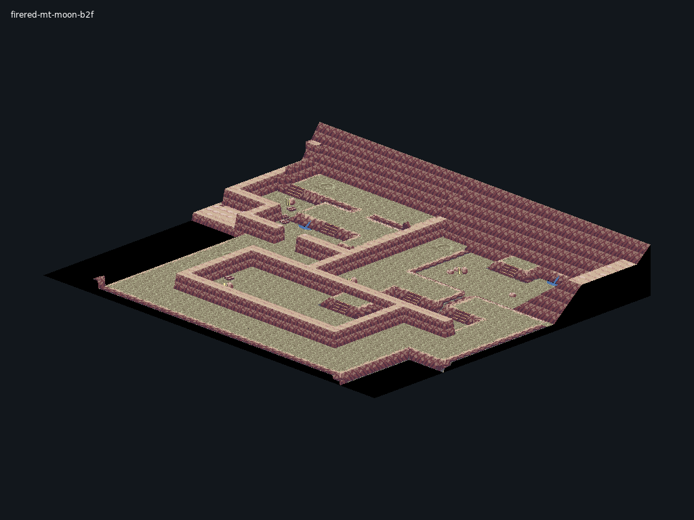
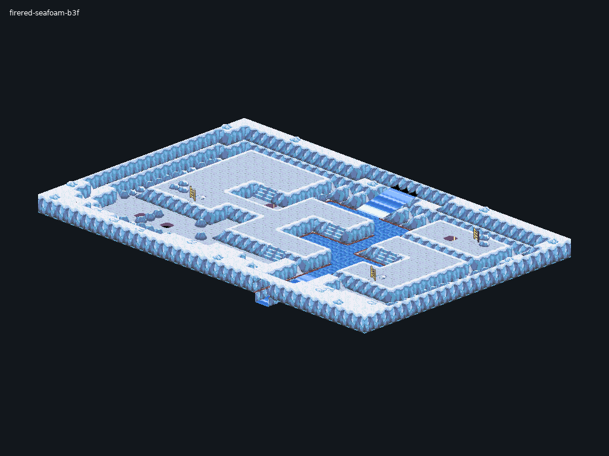

# FRLG Voxel Engine — beta

A 3D voxel/render engine for FireRed and LeafGreen, built for a compatible
Gen1Recomp Gen 3 host. This beta includes the latest reviewed buildings and
20 cave maps, plus foliage rendering and optional mod integrations.

**Engine only:** the host, game data and optional gameplay mods are supplied
separately. No ROMs or saves are included.

## What has been overhauled

- **Buildings:** shaped roofs, overhangs and trim, complete side/rear walls,
  and special building profiles using the original artwork.
- **Caves:** raised shelves, walls, stairs, ladders and height-aware surfaces
  across Mt. Moon, Rock Tunnel, Seafoam, Victory Road, Cerulean Cave and more.
- **Water and terrain:** native water animation and Seafoam waterfall drops.
- **Foliage:** grass, trees and native plant placement; ready for further work.

### Buildings

### Mt. Moon B2F

### Seafoam Islands B3F

These are development previews. The building image comes from the reviewed
exterior pass; cave images were captured through the beta runtime. Mt. Moon
B2F still has a polish note. Images do not establish headset acceptance.

## Install

1. Use a compatible Gen 3 host and your own game data.
2. Download the ZIP from **Releases**.
3. Extract **only `FRLG_VOXEL`** into the host's mods folder, replacing the old
   engine folder. No separate compatibility mod is required.

All engine compatibility code starts automatically from `FRLG_VOXEL`. When
upgrading from beta 1, remove its separate `VRITK_FRLG_HOST` folder. Keep your
save files; this update does not require a new game.

The tested integration baseline is Gen 3 Lab 62
(`0.3.33-gen3.lab.62-runtime-fixes-wilds171`), with mod API 2 and LÖVE graphics.
Quest also needs the host's OpenXR support. Other host releases are unverified.

## Mod compatibility

These optional integrations are included as adapters. **The mods themselves
are not bundled.** Use compatible versions from the existing Gen 3 lab stack;
this is not a claim of compatibility with every upstream version.

| Mod / integration | Support included in this beta |
| --- | --- |
| VRITK / VR Interactions Backpack Lab | Adapters included; older releases using the separate bridge ID need an updated lookup |
| Wilds of Hoenn 1.5.0 / 1.7.1 | FireRed Pokémon/follower drawing starts automatically inside the engine |
| Untamed Advanced / FRLG overworld mons | Provider adapter included; still requires its external Overworld Mons provider |
| TWS / private weather build | Weather and rendering hooks |
| FRLG Catch | Capture hooks included; legacy releases with a bridge dependency need a manifest/lookup update |
| Kanto Gear | Belt/party adapters included; older bridge lookups need updating |
| Portal MR | Optional mixed-reality rendering link |
| FRLG RTC / Emerald Clock bridge | Clock integration hooks |

Older mods that require the old `VRITK_FRLG_HOST` identity are not automatically
compatible with this single-folder beta. Their adapters remain inside the
engine at `FRLG_VOXEL.exports.compatibility`; those consumers need to use that
interface. The old host's bridge-specific HD-sprites guard is also unverified
without that separate mod entry. Do not treat included adapters as full
acceptance of those legacy combinations.

The renderer/profile loader works without these optional mods. Adapter
discovery and lifecycle checks pass; full gameplay with every mod combination
and Quest headset testing remain pending. Large caves can hitch during cold
loading. See [technical notes](docs/TECHNICAL_NOTES.md) for verification details.

## Working on foliage

Start with `FRLG_VOXEL/lib/grass/`, `lib/mesh/FrlgNativeFoliage.lua` and
`lib/render/FrlgTreeView.lua` inside the engine. Keep accepted buildings and
cave layouts intact, and include before/after screenshots with changes.
Never submit ROMs, extracted game files or personal saves.

## License

Private, noncommercial beta use under [LICENSE.txt](LICENSE.txt). Public
releases of beta-derived forks require **HimioneGranger's explicit written
permission**, subject to GitHub-required viewing/forking and third-party rights.
The engine's original code will become open source at full release; that
release will name its license. See [third-party notices](THIRD_PARTY_NOTICES.md).
